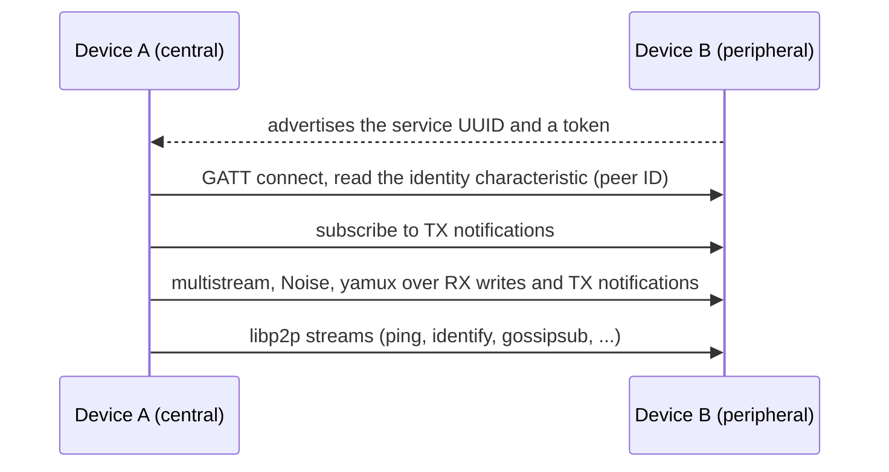

# dart_libp2p_ble

dart_libp2p_ble is the libp2p **Bluetooth LE transport** for
[dart_libp2p](../../dart-libp2p/doc/index.md). Phones and Macs that are near
each other connect **without a network**: no Wi-Fi, no cellular, no relay.

Each connection is one GATT link between two devices. libp2p treats it as it
treats a TCP connection: the upgrader secures it with Noise and multiplexes
it with yamux. Your stream handlers, identify, ping and gossipsub work over
it unchanged.



Every node advertises and scans. [Discovery](discovery.md) connects the
nodes in range, at most four links per node, and gossipsub carries messages
across the partial mesh, so a message reaches devices that are out of range
of the sender.

```sh
flutter pub add dart_libp2p_ble
```

## What you get

| Feature | Notes |
|---|---|
| `/ble/<token>` transport | `BleTransport` dials and listens. A connection is a GATT link; Noise and yamux run on it as on TCP. |
| Android, iOS, macOS | `BluetoothLowEnergyRadio` runs on the [bluetooth_low_energy](https://pub.dev/packages/bluetooth_low_energy) plugin. Every device is a central and a peripheral at the same time. |
| Nearby discovery | `BleDiscovery` finds nodes that advertise the service, reads their peer IDs, and connects. Two nodes make one connection, not two. |
| Mesh | Gossipsub and other protocols relay across the links, so devices out of range of each other still get messages. |
| Tests without Bluetooth | `FakeBleNetwork` gives in-memory radios with range control, so you can test a mesh on your laptop or in CI. |

## Guides

- [Getting started](getting-started.md): install, set up a host on BLE, and connect to nearby devices.
- [Platforms](platforms.md): permissions for Android, iOS and macOS, and what is different on each.
- [Discovery](discovery.md): how nodes find each other and decide who dials, and its settings.
- [Testing without Bluetooth](testing.md): in-memory radios, range control, and a mesh example.
- [How it works](how-it-works.md): the GATT service, advertising, framing, measured speed, and limits.

Every code sample in these guides comes from a program in
[`example/`](../example). The test suite checks that the guides match the
programs and runs the in-memory example.
